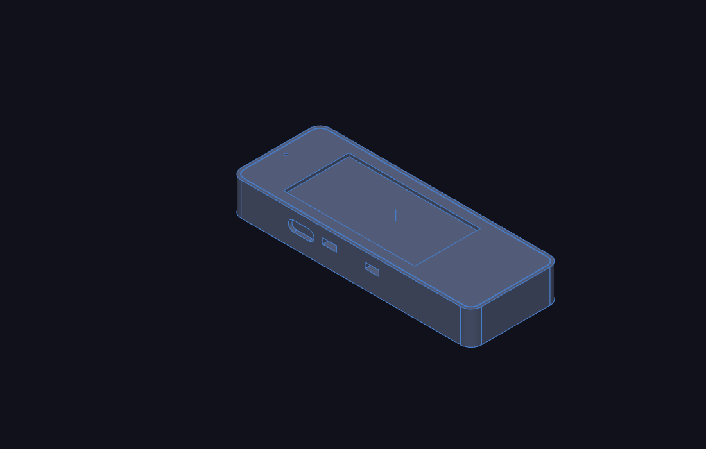

# ARA — case (bottom shell + screen bezel) — v0

**Status: geometry built and overlap-checked, not printed, not fit-tested.**
Rectangular, 90.8 × 33.8 × 12.5 mm assembled. Two printable bodies and 23
component ghosts in one SolidCraft design; `inspect.clearance` over all 25
bodies reports no overlap. Five items are blocking before a print is worth
doing — see **Blocking**.



The iso view shows the right long wall (USB-C opening, two button openings)
with the top end toward the lower right. Back face (top end to the right,
speaker grille and the two screws at the bottom end):


## Files

| File                                    | Content                                                                                         |
| --------------------------------------- | ----------------------------------------------------------------------------------------------- |
| `ara_case.sc`                           | SolidCraft source: parameters, both printable bodies, all ghosts (`G_*`)                        |
| `ara_bottom_shell.stl`                  | Bottom shell, as modelled (Z up, back face on the bed)                                          |
| `ara_bezel.stl`                         | Screen bezel with its posts, hooks and panel stops, as modelled (flip to print front-face down) |
| `ara_case_assembly.step`                | All 25 bodies, for import into other CAD                                                        |
| `ara_case_iso.png`, `ara_case_back.png` | Renders of the current model                                                                    |

## Axes and orientation words

Model axes: X along the length, Y across the width, Z from the back face
(z = 0) to the front (display side). Origin at the centre of the outline.

| Word                  | Meaning in the model                            | What is there                                          |
| --------------------- | ----------------------------------------------- | ------------------------------------------------------ |
| **top** (end)         | **+X**, the end with the two plastic hooks      | Antenna, hooks. No metal.                              |
| **bottom** (end)      | **−X**, the end with the two screws             | Screws and posts, speaker, mic port, display FPC fold. |
| **back face**         | z = 0                                           | Speaker grille, screw heads.                           |
| **top plate**         | the bezel, +Z                                   | Screen side.                                           |
| left / right          | +Y / −Y, looking at the display with the top up | USB-C is on the right wall.                            |
| horizontal / vertical | along Y / along X                               | Device held in portrait.                               |

The firmware draws the panel in portrait with +X up; the panel's FPC tail
is then at the bottom.

## Stack (Z)

| z (mm)      | Layer                                                                                                                                                  |
| ----------- | ------------------------------------------------------------------------------------------------------------------------------------------------------ |
| 0 → 1.6     | back wall (`floor_t`), speaker grille; locally 0 → 3.0 under the two screws                                                                            |
| 1.6 → 8.6   | battery (7.0); speaker (1.6 → 4.8) at the bottom end                                                                                                   |
| 8.6 → 8.9   | gap battery → PCB (`batt_gap` 0.3)                                                                                                                     |
| 8.9 → 9.9   | PCB (`pcb_t` 1.0), every component on its back-facing side; tallest: JST-PH header 3.4 → 8.9, USB-C 5.7 → 8.9, module 5.8 → 8.9, inductor L1 5.9 → 8.9 |
| 9.9 → 10.3  | foam pad, compressed (`disp_gap` 0.4)                                                                                                                  |
| 10.3 → 11.3 | display panel (1.0)                                                                                                                                    |
| 11.3 → 12.5 | bezel (`bezel_t` 1.2), flush with the shell rim; its underside bears on the panel border (`top_gap` 0)                                                 |

The PCB rests on a 1.2 mm ledge (`ledge`) running along both long walls at
z = 8.9, interrupted at the four switches and at the USB-C. The bezel drops
into a rabbet in the rim: 1.0 mm outer lip (`lip`), 0.15 mm fit per side
(`bez_fit`).

## Layout (XY)

Length is set by one sum, all named parameters:

`cav_l = fpc_fold 6.0 + disp_l 59.2 + ant_keepout 15.0 + ant_l 6.0 + ant_gap 0.6 = 86.8`,
`L = cav_l + 2·wall = 90.8`. Width: `W = disp_w 29.2 + 2·fit 0.3 + 2·wall 2.0 = 33.8`.

`fpc_fold = post_clear 1.5 + post_d 4.0 + 0.5 = 6.0` is the strip between
the bottom end wall and the panel. With the USB-C on a long wall it is no
longer set by the receptacle but by the two bezel posts, which stand in
that strip because the panel fills the full width everywhere else and the
top end must stay metal-free. 87.8 mm (`fpc_fold` 3.0, the FPC fold alone)
is not reachable with Ø4.0 posts for M2 screws at the bottom end: the
posts need 1.5 mm to the end wall to swing in (see **Assembly**), their
own 4.0 mm, and 0.5 mm to the panel.

That strip also sets the board area. The floor is used end to end —
posts 5.8, speaker 14.0, a 9.9 mm zone for the tall parts, battery 30.0,
0.5, module and antenna 25.5, 0.6 — so every millimetre taken off
`fpc_fold` comes out of the 9.9 mm zone (`models/pcb/README.md`, *Margins*).
At 6.0 that zone is full.

| Item                           | X range            | Y range             | Note                                                                                             |
| ------------------------------ | ------------------ | ------------------- | ------------------------------------------------------------------------------------------------ |
| PCB                            | −43.15 → 36.8      | ±14.65              | one slot and two post holes, below                                                               |
| Display outline                | −37.4 → 21.8       | ±14.6               | FPC end at −X (bottom)                                                                           |
| Display active area            | −29.45 → 19.10     | ±11.85              | from the panel drawing, see **Display window**                                                   |
| Bezel window                   | −29.95 → 19.60     | ±12.35              | active area + 0.5 margin                                                                         |
| ESP32 module body              | 17.3 → 36.8        | ±9.0                | on the PCB back side                                                                             |
| Antenna                        | 36.8 → 42.8        | ±9.0                | overhangs the PCB edge (PCB ends at 36.8)                                                        |
| Battery                        | −13.2 → 16.8       | ±10.0               | on the floor; nothing can sit on the PCB above it                                                |
| Battery lead end (`G_BattPCM`) | −15.2 → −13.2      | ±10.0               | allowance, z 1.6 → 5.6 only; see Blocking 1                                                      |
| Speaker                        | −37.6 → −23.6      | ±10.0               | on the floor, 20 mm side along Y; grille 3 × 5 holes Ø1.5, pitch 3.0, centred under it           |
| USB-C                          | −23.22 → −14.28    | −15.9 → −8.75       | right wall, under the PCB, z 5.7 → 8.9; mouth 1.0 mm behind the wall's outer face (`usb_recess`) |
| FPC slot in the PCB            | −39.6 → −36.9      | −6.8 → 7.2          | `fpc_slot` 2.7 × `fpc_slot_w` 14.0, centred on the tail                                          |
| FPC connector                  | −31.7 → −26.1      | −7.35 → 7.75        | PCB back side, mouth toward the slot, 5.7 mm inboard of the panel end (`fpc_run`)                |
| JST-PH header                  | −23.1 → −15.2      | 4.2 → 11.8          | mouth toward −Y                                                                                  |
| Inductor L1 (`G_L1`)           | −36.55 → −32.55    | 9.1 → 13.1          | the one display-boost part taller than 1.35 mm                                                   |
| Bezel posts / screws           | x = −39.9          | y = ±11.5           | Ø4.0 posts through Ø4.4 PCB holes                                                                |
| Bezel hooks                    | at the +X end wall | 6 → 12 on each side | plastic only                                                                                     |
| Buttons                        | centred at x = ±8  | both long walls     | openings 5.2 × 2.1 mm, z 6.9 → 9.0                                                               |
| Mic port                       | x = −41.375        | y = 0               | Ø1.0 through the bezel, in the strip below the display                                           |

**Battery access:** by full split — two screws out, shell off, unplug the
JST-PH from the PCB's back side.

## Display window

Good Display's mechanical drawing of the GDEY0213B74 gives what the model
needed: along the length the active area starts 0.45 + 1.45 + 0.40 + 0.40 =
2.70 mm from the panel's top (non-FPC) end (`act_top`) and stops 7.95 mm
short of the FPC end; across the width it is centred, 2.75 mm per side. The
active area therefore sits 2.625 mm toward the top of the outline
(`act_off_x = disp_l/2 − act_top − act_l/2`), and the window follows it.

How far the display could be moved toward the top:

- **The panel: 0 mm.** Its top end is at x = 21.8, exactly `ant_keepout`
  15.00 mm behind the antenna base line (x = 36.8). Measured in 3D the
  panel is 15.07 mm from the antenna (it lies 1.4 mm higher); the keep-out
  would be met down to 14.93 mm of horizontal distance, 0.07 mm closer.
  That 0.07 mm is left as margin.
- **The window: 2.625 mm**, from centred on the outline to centred on the
  real active area. Its top edge is now 2.20 mm from the panel's top end,
  17.20 mm from the antenna base line. It cannot go further: 0.5 mm beyond
  the active area it already shows 0.1 mm of the border outside the
  drawing's 49.35 × 24.50 viewing area, and past that the opening would
  only uncover dead panel.

Result on the front face: 25.8 mm of bezel above the window, 15.45 mm
below; the window's centre is 5.18 mm below the centre of the case. That
remainder is the antenna zone itself (15.0 keep-out + 6.0 antenna + 0.6
gap + 2.0 wall, against 6.0 + 2.0 at the bottom); only `ant_keepout`
changes it.

## USB-C

On the right long wall (−Y), centre 26.65 mm from the bottom end's outer
face (`usb_x`), between the screw post and the lower right button: 3.3 mm
of wall remain between its opening and the button opening. The opening is
a stadium, 9.64 × 3.90 mm, end radius 1.95 — the shell outline 8.94 × 3.2
plus `usb_clr` 0.35 all round — cut through the 2.0 mm wall and the 1.2 mm
ledge. The ghost is the same stadium without clearance, 7.15 mm deep.

The receptacle is the **SHOU HAN TYPE-C 6P(073)**, LCSC C668623, the
on-board version of the family: its body sits on the PCB's back side and
overhangs the board edge by 1.25 mm. Body 8.94 × 3.2 mm, 6.80 mm shell
depth, 7.15 mm overall, from its drawing. The `CB1.6` version previously
listed is a sunk-board type: its shell sits 1.60 mm into a board cut-out,
which on this 1.0 mm board comes out 0.6 mm on the display side, into a
0.4 mm gap. On the end wall that spot was clear of the panel; on a long
wall the panel covers it. Same shell, same pads, different mounting.

On the long wall the receptacle is no longer in series with the display
FPC, which is where the 3.0 mm of length came from.

## Display FPC routing

The tail comes off the panel's bottom end, turns down through the PCB slot
and folds back under the board into the connector on the back side —
`G_FPCTail` models that path.

From the panel drawing: tail 12.50 mm wide, 0.30 ± 0.03 mm thick at the
contacts, stiffener 6.0 ± 0.5 mm, 14.30 ± 0.30 mm long past the panel end,
its left edge 8.15 ± 0.3 mm from the panel's left edge — its centre is
0.2 mm left of the panel centre (`fpc_off_y`). Slot, tail ghost and
connector are centred there. Pin 1 is on the left (+Y).

The connector mouth is 5.7 mm inboard of the panel end. With 3.4 mm of the
tail inside the connector (assumed, not from a drawing) 10.9 mm remain
free; folded as a half-circle between the panel's back and the run under
the board (2.7 mm apart) the loop reaches 1.98 mm past the panel end. The
slot's outer edge is 2.2 mm past it.

`G_FPCTail` is an idealisation of that path: square corners, 1.0 mm past
the panel end, 0.3 mm thick throughout.

## Assembly and retention

The bezel carries everything; the bottom shell is the lid.

1. Bezel face down. The panel goes in **from behind**, face against the
   bezel underside. It cannot go through: the window (49.55 × 24.7) is
   smaller than the outline (59.2 × 29.2) — 2.25 mm of overlap on each long
   side, 2.20 mm at the top end, 7.45 mm at the bottom end.
2. Three stops on the bezel underside locate the panel along X, 0.2 mm
   from each end: one at the top end (`PanelStopTop`), two at the bottom
   end either side of the FPC tail (`PanelStopBotA/B`, merged into the
   posts). Along Y the panel is located by the shell walls (0.3 mm per
   side) once closed, and by nothing before that.
3. Foam pad, then the PCB over the two bezel posts, tail through the slot
   into the connector. The posts fix the PCB in X and Y.
4. Battery and speaker in the bottom shell, JST-PH plugged, speaker wires
   on their pads.
5. The two hook noses at the bezel's top end go into pockets in the
   shell's +X end wall; the shell swings closed and two screws go in from
   the back face, through the floor, into the posts.

The panel has no retention feature of its own. Closed, it is held between
the bezel underside (contact) and the foam on the PCB, the PCB on its
ledges; the hooks and screws are what keep that stack shut.

| Feature                  | Body  | Geometry                                                                                                                     |
| ------------------------ | ----- | ---------------------------------------------------------------------------------------------------------------------------- |
| Posts ×2                 | bezel | Ø4.0, z 3.1 → 11.3, pilot Ø1.7 × 7.2 deep (z 3.0 → 10.2); 1.5 mm from the end wall, 0.5 mm from the panel end                |
| Screw seats ×2           | shell | floor thickened to 3.0, Ø2.2 through, Ø4.2 × 1.8 counterbore from the back                                                   |
| Hooks ×2                 | bezel | tongue 1.2 × 6 × 2.0 under the plate, nose 0.9 mm into the wall, z 9.5 → 10.5                                                |
| Hook pockets ×2          | shell | 1.0 deep × 6.6 × 1.35, z 9.3 → 10.65; 1.0 mm of wall left outside                                                            |
| Screws ×2 (`G_Screw1/2`) | ghost | **M2 × 8 pan head Phillips machine screw**, B&F `MPMS 002 0008 PH` (DigiKey H739-ND); head Ø3.85 × 1.52, shank drawn at Ø1.6 |

Screw choice: M2 rather than M1.6 — neither LCSC nor DigiKey lists a
thread-forming screw for plastic in either size, and M2 × 0.4 machine
screws are the stock item; the screw cuts its own thread in the printed
Ø1.7 pilot. 8 mm rather than 5 mm (the other length DigiKey stocks; there
is no 6 mm): the head seats at z = 1.8, the tip reaches z = 9.8, 6.7 mm
inside the post against 3.7 mm, and stays 0.4 mm short of the pilot's end
and 1.77 mm from the panel.

Closing: the post tips are 9.4 mm below the bezel's top face and 83 mm
from the hook line, so they swing about 9.4² / 83 ≈ 1.1 mm toward the end
wall as they enter. `post_clear` is 1.5 mm.

No metal at the antenna end: the hooks are printed, the screws are 74.9 mm
from the antenna.

## Measured

Volumes and boxes (`measure`):

| Body          | Bounding box (mm)  | Volume measured | Faces      |
| ------------- | ------------------ | --------------- | ---------- |
| `BottomShell` | 90.8 × 33.8 × 12.5 | 10 946.41 mm³   | 90, closed |
| `Bezel`       | 88.55 × 31.5 × 9.4 | 2 115.05 mm³    | 56, closed |
| `G_PCB`       | 79.95 × 29.3 × 1.0 | 2 274.32 mm³    | 12, closed |

`G_PCB` computed: 79.95 × 29.3 − 2.7 × 14.0 − 2 × π × 2.2² = 2 274.32 mm².
The two printed bodies were not recomputed by hand. Solid-volume mass at
1.27 g/cm³ (PETG): 13.9 g shell, 2.7 g bezel.

Overlap check, all 25 bodies (`inspect.clearance {}`), verbatim:

```
{"bodies":25,"near":[],"nearest":{},"overlaps":[],"pairs_checked":70,
 "pairs_pruned":230,"pairs_reused":33,"truncated":false,"unchecked":[]}
```

Openings, checked with rays (`view.pick`): a ray along +Y at the USB-C
centre (z = 7.3) reaches the receptacle mouth at y = −15.9 without touching
the shell, and hits the wall at y = −16.9 when lowered to z = 3.0; a ray
down the mic port axis reaches the PCB at z = 9.9; rays at x = −29.4 and
x = −5.35 reach the panel, rays at x = −30.4, 19.9 and 20.4 stop on the
bezel.

Parameter test (`check_parameters {ant_keepout: 10, batt_h: 8, post_d: 4.4,
act_top: 3.2}`): `errors: []`, shell rebuilds to 86.2 × 33.8 × 13.5 mm,
design restored. Ghost positions across the width (Y) are plain numbers;
along the length they follow `cav_l`, except `G_AP2112K`, placed with
plain numbers, and the switches, which follow `btn_x`.

## Antenna keep-out

Rule applied: no metal-bearing part of the device within 15 mm of the
antenna volume (18 × 6 × 3.1 mm box), measured in 3D, in every direction —
stricter than a sideways/forward-only reading. Distances from `G_Antenna`
(`inspect.clearance`, exact faces):

| To                          | Distance (mm) |                                                     |
| --------------------------- | ------------- | --------------------------------------------------- |
| Display panel               | **15.07**     | governs `ant_keepout`; 0.07 mm of margin            |
| Battery                     | 20.00         |                                                     |
| Switches SW1 / SW3          | 26.64         |                                                     |
| AP2112K                     | 35.33         |                                                     |
| Switches SW2 / SW4          | 42.61         |                                                     |
| Battery lead end            | 50.00         |                                                     |
| MAX17048                    | 50.80         |                                                     |
| USB-C                       | 51.08         |                                                     |
| JST-PH                      | 52.00         |                                                     |
| TP4056                      | 54.30         |                                                     |
| Speaker                     | 60.41         |                                                     |
| FPC connector               | 62.90         |                                                     |
| MAX98357A                   | 65.40         |                                                     |
| FPC tail                    | 68.50         |                                                     |
| Inductor L1                 | 69.35         |                                                     |
| Screws                      | 74.92         |                                                     |
| Microphone                  | 76.85         |                                                     |
| Module body, PCB edge       | 0             | by construction; PCB stops at the antenna base line |
| Bezel hook tongue (plastic) | 0.40          | above the antenna                                   |
| Shell end wall (plastic)    | 0.60          |                                                     |

What this does **not** cover: the outside world. The outer wall is 7.9 mm
from the antenna's sides and 2.6 mm from its tip, so a hand or a metal
surface against the +X end is inside 15 mm regardless of the case.

The 15 mm between display and antenna is the largest single term in the
length after the panel. KiCad's library footprint for this module draws
the keep-out as a T (15 mm to each side and ahead of the antenna, nothing
behind its base line); under that reading `ant_keepout` could shrink
toward 0, the case toward ~76 mm, and the window toward the middle of the
face. Left at 15 here; it is one parameter if an RF test says otherwise.

## Margins

Smallest gaps, measured with `inspect.clearance {clearance: 2.6}`:

| Pair                                | Gap (mm)             | Comment                                                         |
| ----------------------------------- | -------------------- | --------------------------------------------------------------- |
| Bezel ↔ display top                 | 0                    | contact by design; tolerance is taken by the foam, not by a gap |
| JST-PH ↔ battery lead-end allowance | 0                    | by construction: the header starts where the allowance ends     |
| Screw shank ↔ post pilot            | 0.05                 | radial; the thread is meant to cut into the post                |
| Hook nose ↔ pocket                  | 0.10 end, 0.15 above | from the feature dimensions; lets the top end lift 0.15         |
| Bezel post ↔ PCB hole               | 0.20                 | radial                                                          |
| USB-C ↔ battery lead-end allowance  | 0.23                 | allowance top z 5.6, receptacle from z 5.7                      |
| Display ↔ side walls                | 0.30                 | `fit`                                                           |
| PCB ↔ battery                       | 0.30                 | **no swelling allowance** for the Li-Po                         |
| Switch body ↔ shell opening         | 0.33                 |                                                                 |
| USB-C shell ↔ opening               | 0.35                 | `usb_clr`                                                       |
| PCB ↔ display                       | 0.40                 | foam, compressed thickness, not chosen                          |
| AP2112K ↔ battery, ↔ ledge wall     | 0.40                 | in the 3.7 mm strip beside the battery                          |
| Battery ↔ module                    | 0.50                 | `batt_mod_gap`                                                  |
| Bezel post ↔ panel end              | 0.50                 | from the parameters                                             |
| Speaker ↔ JST-PH                    | 0.50                 | along X                                                         |
| Antenna ↔ end wall                  | 0.60                 |                                                                 |
| Inductor L1 ↔ ledge wall            | 0.60                 |                                                                 |
| FPC tail ↔ slot edge                | 0.64                 | idealised tail                                                  |
| Microphone ↔ end wall               | 0.70                 |                                                                 |
| FPC tail ↔ bezel underside          | 0.70                 | idealised tail                                                  |
| Bezel post ↔ speaker                | 0.75                 | speaker drawn as a box; the real frame is oval                  |
| Battery ↔ MAX17048                  | 0.80                 |                                                                 |
| Screw head ↔ speaker                | 0.82                 |                                                                 |
| TP4056 ↔ USB-C                      | 0.90                 |                                                                 |
| Battery ↔ USB-C                     | 1.08                 |                                                                 |
| Speaker top ↔ inductor L1           | 1.10                 | vertical                                                        |
| Battery ↔ switches                  | 1.20                 |                                                                 |
| MAX98357A ↔ ledge wall              | 1.20                 |                                                                 |
| Bezel post ↔ inductor L1            | 1.35                 |                                                                 |
| Speaker ↔ USB-C                     | 1.59                 |                                                                 |
| FPC connector ↔ inductor L1         | 1.60                 |                                                                 |
| Microphone ↔ FPC tail               | 1.65                 |                                                                 |
| Screw tip ↔ display                 | 1.77                 |                                                                 |
| Battery ↔ JST-PH                    | 2.00                 | filled by the lead-end allowance below z 5.6                    |
| Speaker top ↔ FPC connector         | 2.10                 | vertical                                                        |
| Speaker ↔ TP4056                    | 2.35                 |                                                                 |

Walls: 2.0 mm sides, 1.6 mm back, 1.0 mm rim lip. At the four corners the
cavity is square inside a 4 mm outer radius, so the wall thins to 1.17 mm
and the bezel seat narrows to 0.17 mm there (computed, not measured).

## Blocking

1. **Battery size is the nominal one.** The ghost is 30 × 20 × 7 mm from
   `docs/DESIGN.md`. EEMB's own product page and the retail listing both
   give 20.5 × 32.0 × 7.3 mm (read from search results; neither says which
   part of the 32 mm is full thickness). 20.5 mm fits (27.4 mm between the ledges). 7.3 mm uses the
   whole 0.3 mm gap under the PCB. The extra 2 mm of length is taken as the
   protection board and lead end: `G_BattPCM` reserves 2.0 mm past the
   cell's −X end up to z = 5.6, and nothing but the USB-C (0.23 mm above
   it) is near. If the real cell is 32 mm at full thickness it meets the
   JST-PH header. Needs a calliper on the cell.
2. **Which face of the FPC tail carries the contacts is not stated** in
   the panel specification. With the fold modelled here, contacts on the
   tail's front face need a top-contact connector, contacts on its back
   face a bottom-contact one. Both variants (Hirose FH12A / FH12) share
   one footprint and the same 5.6 × 15.1 × 2.0 mm ghost; both are on the
   shopping list. Look at the panel before soldering.
3. **No button caps.** The switch is the Alps SKRTLAE010 (ghost 4.5 ×
   3.39 × 1.65 mm). Its actuator tip stops 0.3 mm short of the cavity
   wall; a cap/plunger has to bridge that and the 2.0 mm wall.
4. **Screw thread in printed plastic is untested.** A machine screw in a
   Ø1.7 printed pilot, 6.7 mm engaged, in a Ø4.0 post: whether it holds
   and whether the post splits depends on the print.
5. **USB-C shell legs.** The C668623 drawing recommends a 1.6 mm board;
   this one is 1.0 mm. The leg length is not dimensioned — scaled from the
   drawing it is about 1.0 mm, flush with the board's display side. If the
   legs come through they have to be trimmed: there is 0.4 mm to the panel.

## Unvalidated

- Component heights for the JST-PH header (5.5), TP4056 (1.75), MAX17048
  (0.75), AP2112K (1.45, the SOT-23-5 package maximum) and the switch
  (1.65) are recalled datasheet values; KiCad's 3D models are not
  installed on this machine to check them against. FPC connector (2.0),
  USB-C (3.2), inductor (3.0) and MAX98357A (0.75) are from their
  drawings or `docs/DESIGN.md`.
- The display-boost parts other than L1 (diodes ≤ 1.35 mm, the rest
  lower) have no ghost. They sit under the board where the nearest thing
  below is the speaker, 4.1 mm down, or the floor.
- The mated JST-PH plug and its leads are not modelled. The header's mouth
  faces −Y; the board keeps 3.9 mm in front of it free of parts
  (`models/pcb/README.md`), and the leads have to turn back toward the
  battery within the 9.9 mm zone.
- Closing the case: the hook-and-swing motion has not been simulated; the
  1.1 mm swing above is arithmetic.
- The bezel bears on the panel with no nominal gap. With the foam too
  thick or the print too tall the panel is squeezed; nothing here limits
  that force.
- Nothing fixes the speaker or the battery.
- Mic path: 1.4 mm of open air between the PCB top and the bezel underside
  at the port; needs a gasket or a printed chimney.
- Speaker has no gasket to the grille and no defined back volume.
- 1.0 mm USB-C recess vs. plug engagement.
- The ledge is interrupted for 9.64 mm at the USB-C, 3.3 mm from the lower
  right switch's 5.2 mm interruption.
- Printability: the USB opening is a 9.64 mm bridge with rounded ends in a
  3.2 mm thick wall section, the button openings 5.2 mm, the hook pockets
  6.6 mm; the rim lip is 1.0 mm (2 perimeters at 0.4 mm); the posts are
  8.2 mm tall on a 1.2 mm plate.

## Recommended tests

1. Calliper the real battery (length with its protection board, thickness)
   and look at the panel's FPC contacts; set `batt_l`, `batt_h`, pick the
   connector variant, re-run the clearance check.
2. Print both bodies in PETG; check bezel fit in the rabbet (0.15 mm/side),
   that the hooks engage and the case swings closed with the posts
   clearing the end wall, and that the PCB ledge prints clean without
   support.
3. Drive the two M2 × 8 screws into printed posts, several times; check
   they hold and the posts do not split. Reprint the pilot at Ø1.6 or Ø1.8
   if not.
4. Dry-fit battery, speaker, the JST-PH plug with its leads, and a USB-C
   plug through the opening.
5. Fold a real panel's tail through a 2.7 mm slot in a scrap board and
   check it reaches a connector 5.7 mm inboard without strain.
6. RF: RSSI at a fixed distance with the display in place, then with the
   module slid 5 and 10 mm toward the display, to decide whether
   `ant_keepout` can come down; repeat with the +X end held in a fist.

---

Licence: CC-BY-SA-4.0.
